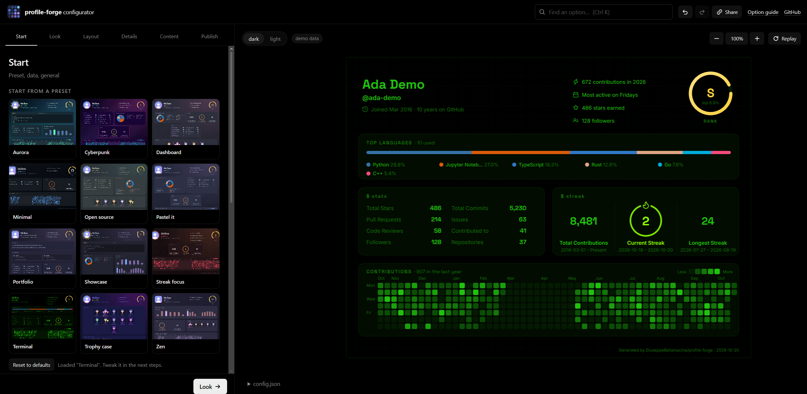

# profile-forge configurator

The web configurator for [profile-forge](https://github.com/GiuseppeBellamacina/profile-forge): **https://giuseppebellamacina.github.io/profile-forge-configurator/**

Design your card with a live preview, then publish everything to your profile repo in one click. React + TypeScript + Vite, built to a static site.



- **Guided steps**: *Start* (preset, data, general) → *Look* (themes, colors) → *Layout* → *Details* (every section's options) → *Content* (about, projects, links, tech stack) → *Publish*. The preview stays visible; on a phone it is a bottom sheet.
- **Live preview** with the real renderer (`profile-forge/src/render.js` is bundled into the page), dark/light slots, demo data or your own numbers.
- **Theme gallery** with a preview of each of the 47 themes, custom themes, per-color overrides.
- **Free grid**: arrange the card like widgets on a phone. Drag a section on the preview to move it, drag its right edge to resize it (6 columns) and its bottom edge to make it taller (both snap: 6 columns, rows of 80px); sections fall to the lowest free spot so gaps fill themselves. Written as `grid` in `config.json`; the simple row layout is still there.
- **Import what you already have**: paste or upload a `config.json` and every control in every step shows its values, or sign in and pull your current setup straight from `<login>/<login>`: the `config.json`, only the tech stack icons the config really uses (one request lists the repo files; limits: 250 files, 1 MB each, 8 MB total, the rest are listed as skipped) and your README, previewed with the card in place of its block (rendered by GitHub in a sandboxed frame).
- **Zoom and pan** of the card preview: wheel to zoom, drag to move, double click to fit.
- **Levels, trophies and frames**: one ranking (E, D, C, B, A, S and the animated top 1% level S+) with a colour per level (Look, *Level colors*); the classic trophy cup (laurel from A, two cups at S, three and a shimmer at S+) with options for what it shows, padding and alignment; a rank shape (ring, hexagon, shield) and thickness; and 13 avatar frames, picked from a gallery that shows each one on your own avatar. Pictures and animated examples of everything are in the [profile-forge guide](https://github.com/GiuseppeBellamacina/profile-forge/blob/main/GUIDE.md#header).
- **Heatmap**: plain grid or an animated snake (6 routes, its own colour; those options only appear in snake mode), and cells as squares, circles, triangles, snowflakes, moons (phases by contributions) or a random mix.
- **Presets gallery**, undo / redo (Ctrl Z / Ctrl Y), a search box for any option (Ctrl K), a dot and a reset button on every field that differs from the default.
- **Share a configuration** as a link (`#c=…`, no server) or import / export `config.json`.
- **One-click publish**: `config.json`, `.github/workflows/profile-forge.yml`, the icons under `assets/img/` and the card block in `README.md` go into your `<login>/<login>` repo in a single commit. It can create the repo, shows which files are new / changed, and starts the first workflow run.
- **Sign in with GitHub, no token to paste.** The preview works without signing in (just type your login); signing in is only needed to commit.
- **Prefer not to sign in?** Download a `.zip` of everything, or open pre-filled “new file” pages on github.com.

## Hosting (GitHub Pages)

[`.github/workflows/pages.yml`](.github/workflows/pages.yml) runs on every push to `main`: it checks out [profile-forge](https://github.com/GiuseppeBellamacina/profile-forge) next to this repo (so the page always runs the same renderer, themes, fonts, presets and schema as the GitHub Action), runs the tests, builds with Vite and deploys `dist/`. Run it by hand to build against another profile-forge branch or tag (`core_ref` input).

1. **Settings → Pages → Build and deployment → Source: GitHub Actions.**
2. Push to `main` (or run the workflow manually). The URL is `https://<owner>.github.io/profile-forge-configurator/`.

## Signing in (OAuth backend)

A static page can't keep an OAuth client secret, so sign-in goes through a tiny backend, [`worker/index.js`](worker/index.js) (a Cloudflare Worker, free tier is plenty). It only does the code→token exchange; the token is handed back to the page in the URL *fragment* (never sent to any server) and the worker stores nothing.

```
page ──▶ worker /auth/login ──▶ github.com (approve) ──▶ worker /auth/callback ──▶ page#pf_token=…
```

It uses a full-page redirect instead of a popup, so it works on phones. Your edits are saved in the browser before the redirect and restored on return.

Scopes: `public_repo` + `workflow` by default (enough for a public profile repo). The *“Also read my private contributions”* checkbox asks for `repo` + `read:org` instead (`read:org` lets the API count organizations you belong to privately). Disconnecting revokes the grant.

### Setting it up once

1. Create an OAuth App: **GitHub → Settings → Developer settings → OAuth Apps → New OAuth App**, then **Generate a new client secret**.
   - Homepage URL: `https://<owner>.github.io/profile-forge-configurator/`
   - Authorization callback URL: `https://<your-worker>.workers.dev/auth/callback` (exactly: the worker builds `redirect_uri` from its own origin).
2. Create a read-only token for the pre-login preview: **Settings → Developer settings → Personal access tokens → Fine-grained → Generate**, *Public repositories (read-only)*, no extra permissions.
3. Deploy the worker (needs a free Cloudflare account):

   ```bash
   cd worker
   # edit wrangler.toml: GITHUB_CLIENT_ID and ALLOWED_ORIGINS (origins of your Pages site, and of local dev)
   npx wrangler login
   npx wrangler secret put GITHUB_CLIENT_SECRET    # the OAuth App secret
   npx wrangler secret put GITHUB_PUBLIC_TOKEN     # the read-only token from step 2
   npx wrangler deploy                              # prints https://profile-forge-oauth.<you>.workers.dev
   ```
4. In **this** repo, **Settings → Secrets and variables → Actions → Variables**, add `AUTH_URL` = `https://<your-worker>.workers.dev`, then re-run the Pages workflow. The URL is baked into the page at build time (`VITE_AUTH_URL`).

Without `AUTH_URL` the page can't sign in or preview a profile: it still works as a designer, with demo data and the zip download. There is no token field: users only ever sign in with GitHub, and the token lives in the tab's session storage and is sent only to `api.github.com`.

> [!NOTE]
> An OAuth App can't be limited to a single repository: `public_repo` / `repo` cover all of the user's repos. The app only ever writes to the repo the user picks in the Publish step. For per-repo permissions, switch to a GitHub App.

`ALLOWED_ORIGINS` compares origins only (scheme + host + port), so it doesn't care about the `/profile-forge-configurator/` path. The dev server uses port **8080**, which is already in the list.

## Your real profile in the preview

No sign-in needed: type any public GitHub login and the page fetches it **once** (a few seconds) through the worker's read-only proxy (`/api/graphql`, public data only, mutations refused) and caches it for the tab; every edit re-renders from that data. Sign in only to commit, or to include private contributions (`includePrivate` refetches once, with your own token). `streak.startingYear` is applied to the loaded data without a refetch.

## Development

```bash
git clone https://github.com/GiuseppeBellamacina/profile-forge      # the renderer lives there
git clone https://github.com/GiuseppeBellamacina/profile-forge-configurator
cd profile-forge-configurator
npm install
npm run dev          # http://localhost:8080  (CORE_DIR=path to use another profile-forge checkout)
npm test             # worker tests (node:test) + unit tests (vitest)
npm run build        # typecheck + production build into dist/
npm run e2e          # real clicks and typing in headless Edge/Chrome against `vite preview` (BROWSER=path to override)
```

`scripts/sync-core.js` copies the files the page fetches at runtime (fonts, presets, theme and preset preview images) from the profile-forge checkout into `public/core/` (git-ignored). The renderer itself is imported through the `@core` alias (`vite.config.ts`). Open a step directly with `?step=look` (`start`, `look`, `layout`, `sections`, `content`, `publish`).

### Where to change things

```
src/schema/fields.ts          every simple option as data: label, hint, type, options, step.
                              The forms, the search box, the "modified" dots and the reset buttons all read it.
src/core.ts                   the only file that touches profile-forge's JS (typed facade)
src/store/config.ts           the config being edited: setVal (drops defaults), undo / redo, persistence
src/store/session.ts          GitHub sign-in and the profile used by the preview
src/store/ui.ts               wizard steps, selected slot, search
src/hooks/usePreview.ts       config → card SVG (debounced)
src/components/steps/         one component per wizard step
src/components/editors/       themes, layout, presets, content, publish…
src/components/ui/Fields.tsx  generic field controls
src/lib/                      publish (GitHub REST + generated files), zip, share links, demo data
src/styles/app.css            design tokens (colors, radius) at the top
worker/index.js               OAuth backend (Cloudflare Worker)
```

To add an option profile-forge just gained: add one entry to `src/schema/fields.ts`. A test fails if the entry doesn't match what `config.js` accepts.

MIT, see [LICENSE](LICENSE).
